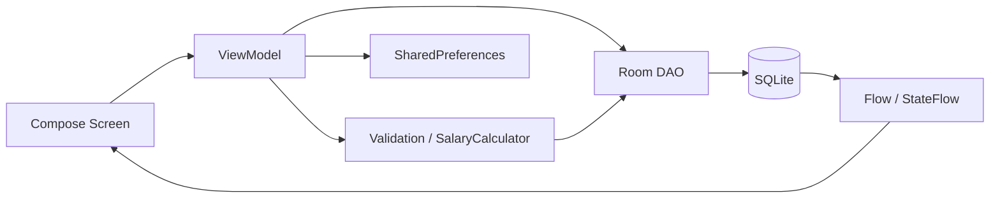

# Báo cáo: Ứng dụng quản lý giờ làm và tiền lương

**Employee Working Hours and Salary Management** — bài thực hành Android viết bằng Kotlin, Jetpack Compose và Room Database. Ứng dụng lưu dữ liệu cục bộ, hỗ trợ hai vai trò Admin và Employee, kết nối quản lý nhân viên → chấm công → tính lương → xác nhận thanh toán.

## 1. Thành viên nhóm

Danh sách tài khoản do nhóm cung cấp:

| Thành viên | GitHub |
| --- | --- |
| Hà Trường Thiện | [@ThienHasagi](https://github.com/ThienHasagi) |
| Phùng Như Ý | [@pnyyy257](https://github.com/pnyyy257) |
| Dương Quốc Hoàng | [@dqhoang4-bot](https://github.com/dqhoang4-bot) |
| Phạm Đức Thành | [@PRTNeroRay](https://github.com/PRTNeroRay) |

Danh sách thành viên không thay thế lịch sử đóng góp. Phần việc cá nhân được xác nhận qua commit, pull request và kết quả kiểm thử/tài liệu của từng người. Xem [hướng dẫn đóng góp](docs/CONTRIBUTING.md).

## 2. Mục tiêu và chức năng

| Vai trò | Chức năng |
| --- | --- |
| Chung | Đăng nhập, ẩn/hiện mật khẩu, lưu phiên, khôi phục dashboard theo vai trò, đăng xuất xóa backstack |
| Admin | Tìm/thêm/sửa/xóa nhân viên; tự tạo tài khoản khi thêm; kiểm tra form và xác nhận xóa |
| Admin | Chọn tháng/năm, tính lương toàn bộ nhân viên, chuyển bảng lương PENDING → PAID |
| Employee | Check In/Check Out, kiểm tra dữ liệu, lịch sử chấm công theo tháng và tổng giờ lũy kế |
| Employee | Xem bảng lương cá nhân: giờ thường, OT, mức lương áp dụng, tổng tiền và trạng thái |

AdminDashboardScreen gồm hai tab **Quản lý Nhân viên / Quản lý Bảng lương**. EmployeeDashboardScreen gồm hai tab **Chấm công & Lịch sử / Bảng lương cá nhân**. Cả hai có nút Đăng xuất ở TopBar, giữ trạng thái khi chuyển tab và hiệu ứng chuyển nội dung.

## 3. Công nghệ và cấu hình

| Thành phần | Cấu hình |
| --- | --- |
| Ngôn ngữ | Kotlin 2.0.21 |
| UI | Jetpack Compose, Material 3 |
| Kiến trúc | ViewModel, Coroutines, Flow/StateFlow |
| Dữ liệu | Room 2.6.1, KSP, SQLite |
| Phiên | SharedPreferences |
| Điều hướng | Navigation Compose 2.8.7 |
| Build | Gradle Wrapper 8.9, Android Gradle Plugin 8.7.3 |
| Android | minSdk 23, compileSdk/targetSdk 35 |
| Java | Target 17; dùng JDK 17 trở lên |

## 4. Kiến trúc chương trình



NavHost chỉ quản lý `login`, `admin_dashboard`, `employee_dashboard`. Các module nằm trong tab của dashboard. Khi đăng nhập/đăng xuất, Navigation xóa graph cũ bằng `popUpTo(graph.id) { inclusive = true }`, tránh quay lại màn hình của phiên trước. ViewModel được scope theo dashboard.

```text
app/src/main/java/com/example/employeemanagement/
├── MainActivity.kt
├── data/
│   ├── local/           # AppDatabase, 4 Entity, 4 DAO, SalaryDetails
│   └── session/         # SharedPrefManager, UserSession
├── domain/
│   ├── attendance/      # Tính thời gian và validation
│   └── salary/          # SalaryMath, SalaryCalculator
└── ui/
    ├── auth/            # LoginScreen, AuthViewModel
    ├── dashboard/       # Hai dashboard có NavigationBar
    ├── navigation/      # AppNavigation
    ├── employee/        # Quản lý nhân viên
    ├── attendance/      # Chấm công và lịch sử
    └── salary/          # Bảng lương Admin/Employee
```

## 5. Thiết kế cơ sở dữ liệu

| Entity | Các trường |
| --- | --- |
| Account | id, username, password, role |
| Employee | id, code, fullname, email, phone, hourlyRate, accountId |
| WorkLog | id, employeeId, workDate, checkInTime, checkOutTime, totalHours, status |
| Salary | id, employeeId, month, year, totalHours, overtimeHours, totalSalary, status |

Các id có kiểu Long và tự tăng. Employee tham chiếu Account; WorkLog/Salary tham chiếu Employee. Các khóa ngoại dùng CASCADE. Username, mã nhân viên, accountId trong Employee và bộ `(employeeId, month, year)` của Salary có unique index.

RoomDatabase.Callback chèn dữ liệu mẫu khi tạo database lần đầu. Thêm Account và Employee diễn ra trong một transaction; cập nhật mã nhân viên đồng bộ username. Xóa nhân viên qua tài khoản cha sẽ xóa cả chấm công và lương liên quan; UI có xác nhận rõ phạm vi xóa.

## 6. Quy tắc dữ liệu và nghiệp vụ

### Nhân viên và đăng nhập

- Form bắt buộc đầy đủ mã, họ tên, email, số điện thoại và mức lương.
- Email đúng định dạng; điện thoại `0` + 9 chữ số hoặc `+84` + 9 chữ số; lương theo giờ hữu hạn và lớn hơn 0.
- Nhân viên mới có username bằng code, password mặc định `123456`, role EMPLOYEE.
- Session lưu isLoggedIn, accountId, employeeId, role, username; không lưu password trong SharedPreferences.
- Employee chỉ truy cập chấm công và bảng lương của employeeId lấy từ phiên. ViewModel kiểm tra quyền trước các thao tác ghi.

### Chấm công

- Ngày `yyyy-MM-dd`, giờ `HH:mm:ss`, lấy theo đồng hồ và múi giờ thiết bị.
- Check In kiểm tra bản ghi hôm nay trong transaction rồi insert CHECKED_IN; chặn lần thứ hai kể cả đã checkout.
- Check Out yêu cầu đã check-in, chưa checkout, đúng ngày và đúng trạng thái. Giờ ra không được sớm hơn giờ vào.
- `totalHours = (secondsOut - secondsIn) / 3600`, làm tròn HALF_UP đến 2 chữ số; hoàn tất chuyển COMPLETED.
- Lịch sử tháng cộng giờ của bản ghi COMPLETED. Các nút bị khóa khi thao tác không phù hợp hoặc đang lưu.

### Tính lương và OT

Chỉ dùng WorkLog COMPLETED trong tháng/năm đã chọn, gom các ca cùng workDate:

```text
dailyOt       = max(0, tổng giờ trong ngày - 8)
totalHours    = tổng giờ các ngày
overtimeHours = tổng dailyOt
totalSalary   = (totalHours - overtimeHours) × hourlyRate
              + overtimeHours × hourlyRate × 1.5
```

Ví dụ: ngày 1 làm 10 giờ, ngày 2 làm 6 giờ, mức lương 50.000 VNĐ/giờ → 16 giờ tổng, 2 giờ OT → **850.000 VNĐ**. Không áp dụng ngưỡng 160 giờ/tháng.

Tính lại cập nhật đúng bản ghi theo nhân viên/tháng/năm và đặt PENDING, kể cả bảng trước đó PAID; UI yêu cầu xác nhận. Admin đánh dấu thanh toán bằng UPDATE có điều kiện PENDING → PAID. Không có giờ COMPLETED thì lương bằng 0.

## 7. Cài đặt và chạy thử

```bash
git clone https://github.com/ThienHasagi/Thuc_hanh_Mobile_2.git
cd Thuc_hanh_Mobile_2
```

Mở project bằng Android Studio, chọn Gradle JDK 17 trở lên, cài SDK 35, Sync Gradle rồi Run module `app` trên Android API 23 trở lên. Lần đầu cần mạng để tải dependency; ứng dụng sử dụng dữ liệu cục bộ khi chạy. Android Studio tạo `local.properties` riêng cho SDK của máy.

**APK chạy thử:** [EmployeeManagement-debug.apk](artifacts/EmployeeManagement-debug.apk). Đây là APK debug đã ký, dùng cho cài đặt/demo.

| Username | Password | Vai trò / hồ sơ |
| --- | --- | --- |
| admin | 123456 | ADMIN |
| emp01 | 123456 | EMPLOYEE / NV01 |
| emp02 | 123456 | EMPLOYEE / NV02 |

Hai nhân viên mẫu có hourlyRate = 50.000 VNĐ. WorkLog và Salary ban đầu rỗng. Dữ liệu mẫu không tự chèn lại mỗi lần mở app.

## 8. Kiểm thử và kết quả

```powershell
.\gradlew.bat :app:assembleDebug :app:assembleDebugAndroidTest :app:testDebugUnitTest :app:lintDebug
```

Thêm `--offline` nếu dependency đã có đầy đủ trong cache. Kết quả xác minh bản tích hợp:

| Kiểm tra | Kết quả |
| --- | --- |
| Build APK debug | Thành công |
| Biên dịch APK instrumentation test | Thành công |
| Unit test chấm công/validation | 14/14 đạt |
| Unit test công thức lương | 7/7 đạt |
| Android Lint | Không có lỗi; còn cảnh báo không chặn build |
| Instrumentation test Room/Auth/Compose | 12/12 đạt ở giai đoạn Login/Session trên Android 13; sau khi ráp dashboard, test đã cập nhật và biên dịch, chưa chạy lại emulator |

Chạy toàn bộ kiểm thử thiết bị khi có emulator hoặc điện thoại:

```powershell
.\gradlew.bat :app:connectedDebugAndroidTest
```

## 9. Kịch bản trình diễn

1. Admin đăng nhập, thêm/tìm/sửa nhân viên ở tab Nhân viên.
2. Employee đăng nhập, Check In rồi Check Out; quan sát khóa nút và lịch sử tháng.
3. Admin chọn đúng tháng/năm, tính lương, xem giờ thường/OT rồi chuyển PAID.
4. Employee mở tab Bảng lương cá nhân để kiểm tra kết quả và trạng thái.
5. Đóng/mở app để kiểm tra lưu phiên; đăng xuất và nhấn Back để kiểm tra không trở lại dashboard cũ.

Hướng dẫn chi tiết: [SUBMISSION_GUIDE.md](SUBMISSION_GUIDE.md). Giải thích từng module và code: [IMPLEMENTATION_GUIDE.md](docs/IMPLEMENTATION_GUIDE.md).

## 10. Giới hạn và hướng phát triển

- Bản thực hành xác thực cục bộ; password trong Account hiện lưu String theo đề bài. Chưa có backend hoặc xác thực dùng cho môi trường thực tế.
- Chấm công chỉ xử lý trong ngày, chưa hỗ trợ ca qua đêm; thời gian phụ thuộc đồng hồ thiết bị.
- Lương theo công thức đề bài, chưa có phụ cấp/khấu trừ. Salary chưa có trường lưu mức lương lịch sử riêng; UI suy ra mức lương áp dụng từ kết quả khi tổng giờ lớn hơn 0.
- Hướng mở rộng: đồng bộ backend, phân quyền phía máy chủ, lưu lịch sử mức lương, xử lý ca qua đêm và xuất báo cáo.
